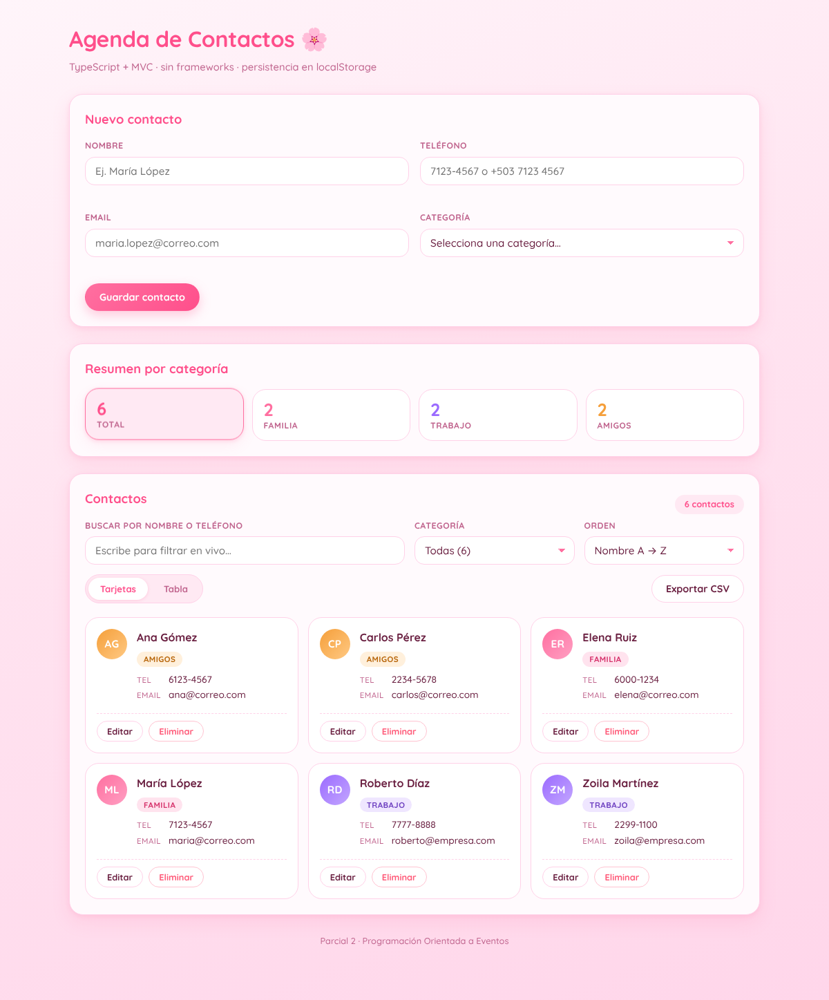
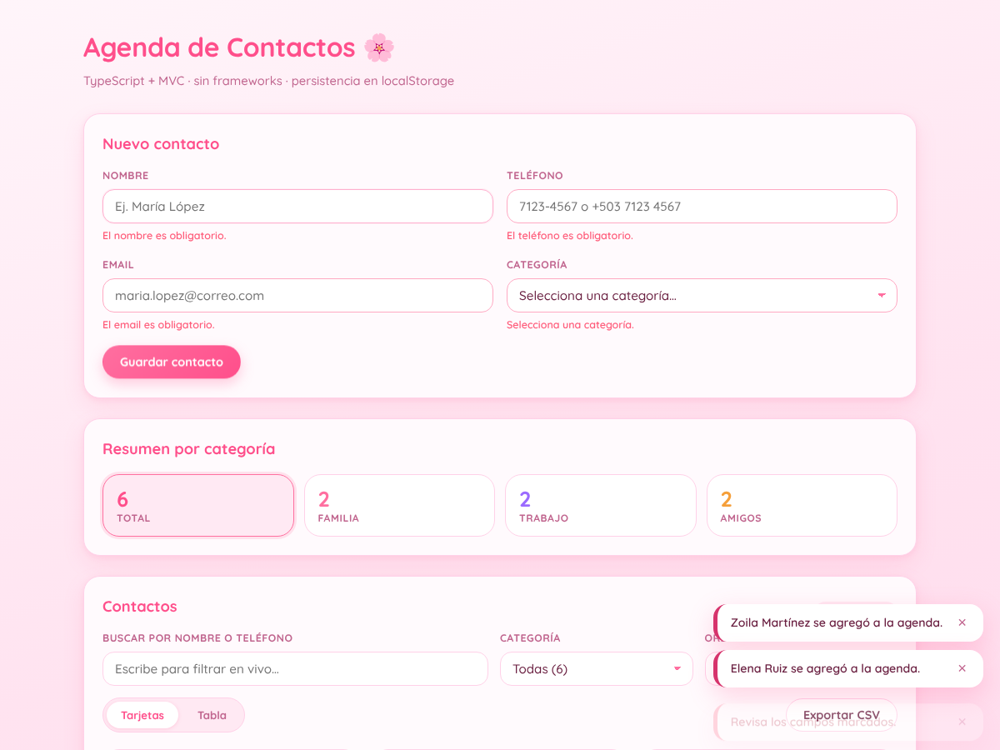
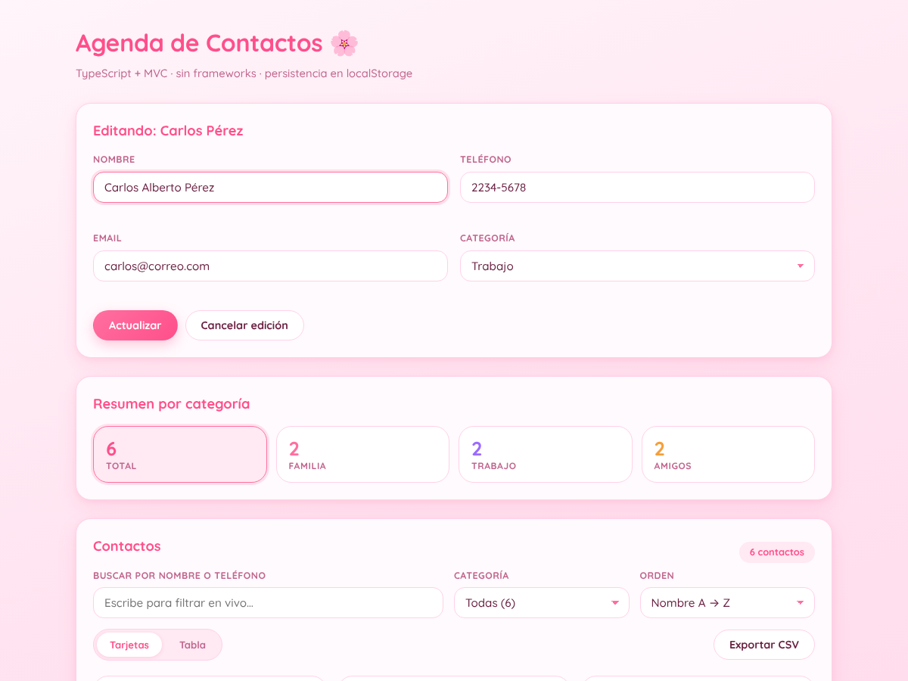
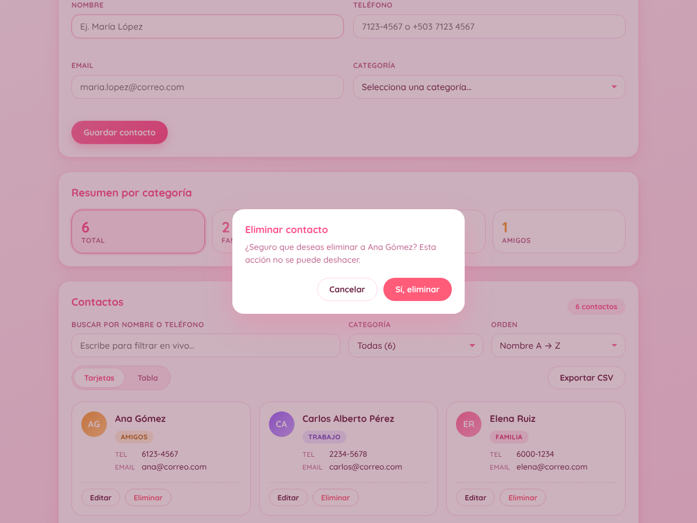
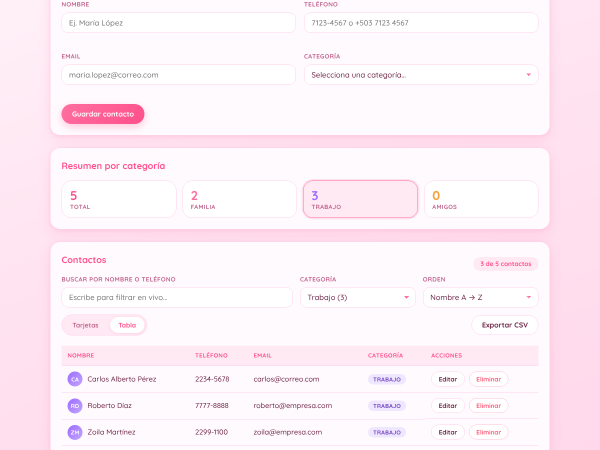
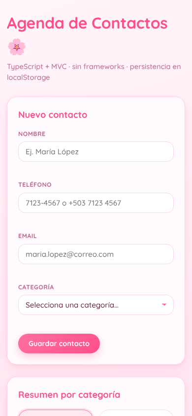

# Agenda de Contactos — Parcial 2

Aplicación web para gestionar contactos (nombre, teléfono, email y categoría). Construida con **TypeScript, HTML y CSS puros**, sin frameworks ni empaquetador, usando el patrón **MVC** + una capa de servicio. Los datos persisten en `localStorage`.

Este repositorio es la **continuación del Laboratorio #2** (Proyecto 2 — Agenda de Contactos) con los nuevos requerimientos del **Parcial 2** de Programación Orientada a Eventos.



## Requisitos

- Node.js 18+
- pnpm

## Uso

```bash
pnpm install   # instala TypeScript y serve
pnpm build     # compila src/ -> dist/
pnpm start     # sirve la app en localhost:5839 (funciona igual en Windows, Linux y macOS)
```

Otros scripts útiles: `pnpm watch` (recompila al guardar) y `pnpm typecheck` (solo revisa tipos).

> ⚠️ **No abras `index.html` con doble clic.** El proyecto usa módulos ES (`import`/`export`), y el navegador bloquea módulos cargados vía `file://` por CORS. Además, `crypto.randomUUID` solo funciona en contextos seguros (`http(s)` o `localhost`). Por eso es obligatorio servir los archivos por HTTP (`pnpm start`, Live Server, `npx serve`, etc.).

## Novedades del Parcial 2

| Requerimiento | Implementación |
| --- | --- |
| **RF-01** Categoría (familia, trabajo, amigos) | Nuevo campo `categoria` en `Contacto`, tipo `Categoria` (unión literal) y `<select>` obligatorio en el formulario. |
| **RF-02** Editar contactos | Botón *Editar* carga los datos en el formulario, el botón cambia a **Actualizar** y aparece *Cancelar edición*. `ContactoModel.updateContacto()` + `ContactoController.handleUpdate()`. |
| **RF-03** Eliminar con confirmación | Modal "¿Seguro que deseas eliminar…?" (cierra con *Cancelar*, clic fuera o `Esc`). `deleteContacto()` + `handleDelete()`. |
| **RF-04** Filtrar por categoría | `<select>` con evento `change` y clic en las tarjetas del resumen. Se **combina** con la búsqueda y el orden. `filterByCategory()` + `handleFilter()`. |
| **RF-05** Ordenar alfabéticamente | Selector A → Z / Z → A con `localeCompare('es')` (respeta tildes y ñ). `sortByName()`. |
| **RF-06** Guardar en localStorage | `StorageService` (clave `agenda-contactos.v2`). Migra automáticamente los datos del Laboratorio #2 (clave v1, sin categoría → *Amigos*). |
| **RF-07** Avatar con iniciales | `renderAvatar()`: círculo con las iniciales y el color de la categoría, en tarjetas y en tabla. |
| **RF-08** Email único | Se rechaza un email ya registrado (sin distinguir mayúsculas), excepto al editar el mismo contacto. |
| **RF-09** Contador por categoría | Panel *Resumen por categoría* (Total / Familia / Trabajo / Amigos) y conteo dentro del filtro. |
| **Reto** Exportar a CSV | Botón *Exportar CSV*: descarga lo que se está viendo (búsqueda + filtro + orden), con BOM UTF-8 para que Excel muestre bien las tildes. |

También se agregaron **notificaciones con auto-cierre** (éxito, error, info; máximo 3 a la vez), y el error de cada campo se limpia al corregirlo.

## Estructura

```
index.html
package.json
tsconfig.json
src/
  main.ts                            # ensambla las capas y arranca la app
  models/Contacto.ts                 # entidad + IContacto + tipo Categoria
  models/ContactoModel.ts            # NUEVO: colección, CRUD, validaciones, filtros, orden, CSV
  views/ContactoView.ts              # única clase que toca el DOM
  controllers/ContactoController.ts  # maneja eventos y coordina Vista ↔ Modelo
  services/StorageService.ts         # único acceso a localStorage (+ migración v1 → v2)
  styles/styles.css
docs/capturas/                       # capturas usadas en este README
dist/                                # generado por `pnpm build` (no versionado)
```

Nota: los `import` en `src/` terminan en `.js` aunque los archivos sean `.ts`; es el requisito de los módulos ES nativos, y TypeScript lo resuelve igual.

## Arquitectura MVC

```
 ContactoView ──(callbacks: alGuardar, alBuscar, alFiltrar, alOrdenar, alEditar, alEliminar, alExportar)──▶ ContactoController
      ▲                                                                                                        │
      └────────────── renderizar(), mostrarErrores(), notificar(), descargarArchivo() ◀─────────────────────────┤
                                                                                                               ▼
                                                                 ContactoModel ──▶ StorageService ──▶ localStorage
```

- **Modelo**
  - `Contacto`: datos de un contacto y lógica propia (iniciales, coincidencia de búsqueda, serialización).
  - `ContactoModel`: la colección completa y las reglas de negocio — `addContacto()`, `updateContacto()`, `deleteContacto()`, `searchContactos()`, `filterByCategory()`, `sortByName()`, `consultar()` (combina los tres), `getContadorPorCategoria()`, `toCSV()` y `validar()`. No toca el DOM.
- **Vista** (`ContactoView`): renderiza tarjetas/tabla, resumen, filtro (`renderCategoryFilter()`), avatares (`renderAvatar()`), modal y notificaciones; lee el formulario y avisa al controlador. No valida ni decide negocio.
- **Controlador** (`ContactoController`): `handleSubmit()`, `handleUpdate()`, `handleDelete()`, `handleFilter()`, `handleSearch()`, `handleSort()`, `handleExport()`. Mantiene el estado de la consulta (texto + categoría + orden) y el modo edición.
- **Servicio** (`StorageService`): único punto de acceso a `localStorage`, con manejo de errores y migración.

## Validaciones

- **Nombre**: obligatorio, entre 2 y 60 caracteres, solo letras (incluye tildes y ñ), espacios, puntos, guiones y apóstrofos.
- **Teléfono**: formato de El Salvador — 8 dígitos que inicien con `2`, `6` o `7`. Acepta `71234567`, `7123-4567`, `+503 7123 4567`, `(503) 7123-4567` y se normaliza a `7123-4567`. No se permiten duplicados.
- **Email**: formato válido con regex (`texto@dominio.ext`), máximo 100 caracteres, se guarda en minúsculas y **debe ser único**.
- **Categoría**: obligatoria y solo `familia`, `trabajo` o `amigos`.

Cada error muestra un mensaje específico debajo de su campo.



## Capturas

| Modo edición | Confirmación de eliminación |
| --- | --- |
|  |  |

| Vista tabla filtrada por *Trabajo* | Móvil |
| --- | --- |
|  |  |

Ejemplo de CSV exportado: [`docs/capturas/ejemplo.csv`](docs/capturas/ejemplo.csv).

## Cómo probar

1. Agrega un contacto válido (ej. María López, `+503 7123 4567`, `maria@correo.com`, *Familia*) → se guarda como `7123-4567` y aparece una notificación que se cierra sola.
2. Envía el formulario vacío → aparecen 4 mensajes de error específicos.
3. Repite el mismo teléfono o el mismo email (aunque sea en mayúsculas) → error de duplicado.
4. Elige *Trabajo* en el filtro y escribe en el buscador → el listado y el contador combinan ambos criterios.
5. Cambia el orden a Z → A.
6. Edita un contacto y cámbialo de categoría → el resumen por categoría se actualiza.
7. Elimina un contacto → pide confirmación antes de borrar.
8. Pulsa *Exportar CSV* → se descarga un archivo con los contactos visibles.
9. Recarga (F5) → los datos siguen ahí.
